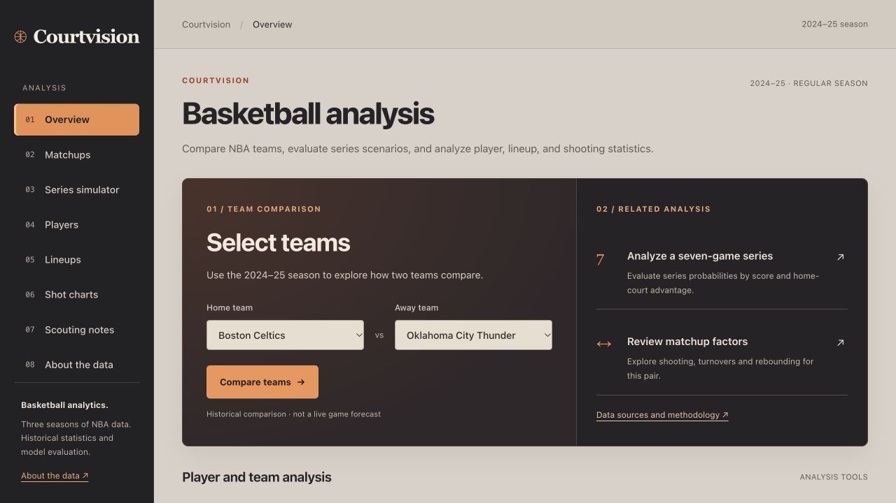

# Courtvision

[Open prototype](https://1tzann.github.io/CourtVision/) · [Public source](https://github.com/1tzAnn/CourtVision) · [Submission description and walkthrough](docs/SUBMISSION.md)

**Historical NBA analysis with reproducible results.**

A reproducible historical NBA research platform. It helps analysts inspect matchups, compare player profiles, investigate observed lineups, and turn statistical patterns into testable coaching hypotheses.

This is a working prototype with real data and measured evaluation results. It is a **2024–25 historical research edition**, not a live prediction or trade recommendation service.



## Open the prototype

Double-click **Courtvision.html** in this folder and open it in Safari, Chrome, or Edge. The complete dashboard, all 35 data files (including every team's shots), styles and model calculations are embedded in that single file. It runs offline without an account, a server, Python, or API keys. Offline system fonts are used. Scenario saves depend on browser storage and the file/site address; use JSON export for backups that survive moving files or changing browsers. Source citations open external websites only when clicked.

This folder contains the editable source, cached original data, trained model artifacts, documentation and tests. You can copy it, back it up, edit it or host it with any provider you choose. Original software is MIT licensed; the sports datasets retain their CC BY 4.0 attribution requirements. No hosting subscription is needed for local use.

After editing the dashboard or rebuilding its data, regenerate the single file:

```sh
python3 scripts/build_standalone.py
```

To refresh the portable source ZIP, run `python3 scripts/package_source.py`. This packages source, cached data, model artifacts, documentation, tests and the standalone app, excluding virtual environments, Git internals and hosting metadata.

## Serve the editable dashboard locally (optional)

Python 3.9+:

```sh
python3 -m http.server 8000 --bind 127.0.0.1 --directory dist
```

Open http://localhost:8000 . The static application runs its exported logistic model in the browser. All analytical data is included. System fonts work offline; no font service is required. No API key is required.

## Run the full local API

Python 3.12 recommended:

```sh
python3 -m venv .venv
source .venv/bin/activate
pip install -r requirements.txt
python -m uvicorn backend.app:app --host 127.0.0.1 --port 8000
```

Dashboard: http://localhost:8000 . API docs: http://localhost:8000/docs . Routes include health, teams, player search, POST matchup inference, evaluation, lineups and shots. The hosted static edition uses the same exported model in browser; it does not host the Python API.

## Features

- Series simulator: exact best-of-seven probabilities, current-score conditioning, home-court comparisons, finishing-score distributions, expected remaining games, Elo sensitivity, eight browser-local saved scenarios, validated JSON import and reproducible JSON export. A hypothetical scenario tool, not a playoff-validated predictor.

- Matchups: model probabilities, model-instability intervals, opponent-adjusted Elo strength, drivers, recent form and home/away records.
- Players: clickable search results, eight-dimension nearest-profile discovery, two-player comparisons, calculated true shooting, per-36 production, role-peer radar, three-season efficiency trends, evidence reports.
- Lineups: five-player builder, observed combinations, minimum-possession filtering, shrinkage-ranked units, and 50/200/500-possession prior sensitivity.
- Shot charts: additive shot-mix/conversion breakdown, zone-level model residuals, small-sample flags, evidence JSON export, 219,527 authentic regular-season attempts, interactive team/player/zone/value filters, half-court map, zone rates and held-out location/context expected points.
- Scouting notes: inspectable tactical hypotheses and an explicitly exploratory Matchup Vulnerability Index.
- About the data: chronological evaluation, calibration, definitions, assumptions, attribution and downloadable results.

## Data and licenses

BoxScore Lab / NBA Stats: three displayed regular seasons of team/player statistics plus 2025–26 team games reserved for a fresh audit. SportsDataverse / hoopR / NBA Stats: three shot seasons for training/validation/testing and 2024–25 observed lineups. Both publishers explicitly license the used data under CC BY 4.0. See [DATA_LICENSES.md](DATA_LICENSES.md). Original software is MIT licensed; third-party data is not relicensed as MIT.

Source URLs, retrieval timestamp and hashes are in `data/provenance.json`. Raw data is cached for reproducible offline use. Lineup coverage may be capped at 2,000 units. Detailed limitations are in [methodology](docs/METHODOLOGY.md).

## Reproduce the analysis

The cached source files are already included. Run `python -m pipeline.rebuild` to rebuild everything, or use the equivalent explicit steps below:

```sh
python pipeline/ingest.py
python pipeline/spatial.py
python pipeline/build.py
python -m pipeline.shot_model
cp data/provenance.json dist/provenance.json
```

The ingestion script requires curl and internet only if a cached file is absent. It does not refresh existing snapshots implicitly. Keep the provenance manifest with its matching source bytes; future upstream files may yield different results.

Before ingestion, cached bytes are checked against all recorded source hashes. A mismatch stops rebuilding instead of replacing the recorded hash. Run `python -m pipeline.integrity` to check all 11 cached files. The full rebuild also refreshes the standalone HTML.

Artifacts: SQLite tables, pregame feature CSV, model coefficients/bootstrap draws, evaluation JSON, compact per-team shots, and browser data. Random seed is 42.

## Evaluation

Training: 2022–23 (1,073 games). Validation: 2023–24 (1,074). Held-out testing: 2024–25 (1,071). The first ten games for each team and neutral-site games without a home designation are ineligible. Model selection uses validation only; final training combines train + validation.

| Model | Test log loss ↓ | Brier ↓ | Accuracy |
|---|---:|---:|---:|
| Home base rate | 0.6899 | 0.2484 | 54.25% |
| Recent net-rating logistic | 0.6231 | 0.2168 | 64.71% |
| Core logistic | 0.6183 | 0.2146 | 65.73% |
| Core + exploratory MVI | 0.6180 | 0.2146 | 65.08% |
| Elo-informed logistic (selected) | 0.6130 | 0.2127 | 66.57% |

Selection optimizes log loss, not accuracy. The tiny MVI improvement does not establish robust incremental value. Limited-season testing, fixed Elo assumptions, rough possession estimates, coarse player roles and absent injuries limit generalization. Never interpret these forecasts as guaranteed results.

## Fresh audit: 2025–26

Experiment 02 was specified before reading these results. Model selection still uses 2023–24 validation only, with no 2024–25 or 2025–26 fitting. The earlier 2024–25 test had already been inspected, so the new season provides an additional audit (1,071 eligible games).

| Model | Log loss ↓ | Brier ↓ | Accuracy |
|---|---:|---:|---:|
| strength | 0.6150 | 0.2133 | 65.55% |
| core | 0.6207 | 0.2161 | 64.61% |
| experimental_mvi | 0.6219 | 0.2167 | 64.24% |
| elo | 0.5996 | 0.2063 | 67.23% |
| home_base_rate | 0.6884 | 0.2477 | 54.90% |

Elo uses fixed K=20, home offset 75, scale 400, and a season-start reset to 1500. The selected logistic model converts the pregame Elo gap to a probability. The UI retains 2024–25 historical teams, shots and lineups. The MVI variant is slightly worse than core on this fresh audit; it remains exploratory.

## Shot-outcome model

A histogram gradient-boosted classifier uses x/y location, distance, two/three-point value, period and period seconds remaining. It predicts conversion conditional on the observed attempt, without defender tracking or player identity. Train: 217,219 shots (2022–23); validate: 218,702 (2023–24); test: 219,527 (2024–25). Test log loss **0.64865** versus **0.67413** for a two/three-point baseline; Brier **0.22881** versus **0.24060**. Full results and calibration are in `dist/shot_evaluation.json`. Predictions for the displayed season are held out, not in-sample.

## Test

```sh
python -m pytest -q
node tests/browser_math.mjs
node tests/scenarios.mjs
node tests/workspace.mjs
node tests/shot_evidence.mjs
python3 scripts/build_standalone.py
node tests/standalone.mjs
```

Tests additionally cover exact series probabilities against an independent exhaustive reference, profile-distance invariance, source integrity and standalone-bundle completeness. Existing tests cover paired game validation, leakage prevention, shot geometry, shrinkage, missing/invalid API inputs, endpoint behavior, sample counts, and all 870 distinct matchup combinations. See [QA record](docs/QA.md) for actual verification performed.

## Architecture

Buildless ES-module frontend with responsive CSS, accessible controls, SVG charts and a canvas shot layer. Python/Pandas/NumPy pipeline; scikit-learn regularized logistic regression; FastAPI local backend; SQLite analytical storage. No frontend build process or paid service is necessary. This deliberately avoids framework complexity while the analytical workflow is being validated.

```text
backend/         FastAPI service
pipeline/        ingestion, validation, model training, spatial transforms
data/raw/        licensed original source snapshots
data/processed/  feature table, SQLite database, model artifact
dist/            self-contained deployable web application
tests/           analytics, API and browser-inference checks
docs/            methodology, scope, QA and competition narrative
```

## Deploy

Static: publish `dist/` to any static host. No rewrite rules are needed; navigation uses hash routes.

API + dashboard: `docker build -t courtvision .` then `docker run --rm -p 8000:8000 courtvision`. Alternatively run the documented uvicorn command on a Python hosting service. Docker configuration is supplied; Docker execution has not been verified in this environment.

The local folder and standalone HTML are the primary deliverables. An earlier private Sites review copy exists, but it is not required to use or develop this project. Future hosting is your choice. A public GitHub repository and a judge-accessible prototype still need to be provided before submission; a file on your computer alone is not publicly accessible.

## Competition value

Practical application: a coherent matchup-to-evidence-to-hypothesis workflow. Analytical insight: chronological validation, baselines, uncertainty and explicit ablation. Data presentation: focused views and accessible explanations. Submission draft and walkthrough are in [docs/SUBMISSION.md](docs/SUBMISSION.md).

## Remaining work this week

Broader multi-season validation; fuller role taxonomy; historical transfer/player-fit evaluation if time permits; external basketball review; final public GitHub publication and judge-accessible deployment. These are not represented as completed features.

### Lineup comparisons

Lineup Lab compares two observed units from the same team, including shared players, offensive/defensive ratings, sample weights, and rankings under 50/200/500-possession priors. Use Export comparison for a JSON evidence record. Defaults are the two most-used eligible units. Filters can reset excluded selections. This is descriptive evidence, not a causal substitution estimate.

Lineup Lab also finds observed alternatives sharing exactly four players with Unit A, ordered by sample size. Use as A in the ranked table and Use as B in the alternatives table connect discovery to comparison. JSON exports include all available team units, the eligible comparison group and ranking formulas for independent reproduction.

### Visual redesign — October 28, 2026

A new paper-and-ink design replaces the dark neon interface. Courtvision now uses plain navigation labels, larger text, warmer colors, and offline system fonts. All eight screens and charts use the new palette. See `docs/DESIGN.md` for design guidance. The offline download is named Courtvision.html.

### Guided start

Overview now opens with two team selectors. Compare the teams, start a best-of-seven series, or open scouting notes with the selected matchup carried across. Each analysis page has an optional plain-language quick guide. Charcoal navigation and orange accents distinguish controls from the warm neutral analysis panels.

### Saved lineup studies

Save up to eight lineup comparisons locally. Restore team, units, possession threshold and prior strength after reloading. Import schema 2 lineup evidence JSON to reopen a comparison; only identifiers and settings are used, and all results are recomputed from bundled data. Browser saves depend on browser profile and file/origin address; exported JSON is the portable backup.

### Rotation finder

In Lineups, Find rotation options filters observed units by one required and one excluded player, using the current possession minimum and shrinkage prior. Export search includes all matches, inputs and available team units. Use as A sends a candidate into the broader comparison pool. This search does not predict injury impact.

## Release verification

Run `.venv/bin/python scripts/check_release.py` with Node available on PATH (or pass `--node /path/to/node`). This verifies source hashes, rebuilds the offline artifact, runs the Python tests and every JavaScript test suite, and writes `docs/release-check.json` only after success. The report fingerprints the exact distributed files. Public GitHub publication and Devpost submission are separate steps; see `docs/SUBMISSION.md`.
